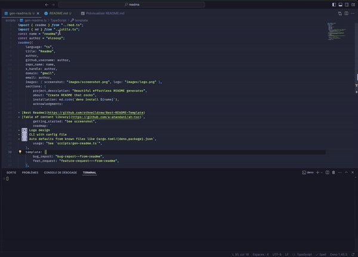

<div align="center">
  
  <p>
    <strong>A beautiful, effortless README generator for modern workspaces.</strong><br/>
    Automatically generates comprehensive, well-structured README files from known project files like <code>deno.json</code>, <code>Cargo.toml</code>, or <code>pnpm-workspace.yaml</code>.
    Features workspace compatibility, automatic shields, and cross-platform support.
  </p>
  <p>
    
    
    
    
    
  </p>
</div>

---

## About the Project

**Readma** is a workspace-compatible documentation generator designed to make README creation effortless. Instead of manually writing and updating documentation, Readma parses your existing project configuration files and automatically generates a standardized, informative README complete with dynamic badges and relevant links.



> [!NOTE]
> This repository serves as the entry point for the Readma monorepo. It is structured as a workspace containing multiple focused packages.

### Workspace Packages

| Package | Description |
| :--- | :--- |
| `@readma/core` | The core engine responsible for parsing project files and generating README content. |
| `@readma/cli` | The command-line interface to easily run and configure the README generation process. |
| `@readma/pkg-json` | A typed utility function to safely read and parse `package.json` files. |

---

## Features

- **Workspace Compatible**: Seamlessly integrates with monorepos and workspaces (Deno, pnpm, Cargo).
- **Automatic Shields**: Dynamically generates relevant badges (version, codecov, issues, pull requests, last commit, release...) based on your project files. Disable any builtin badge or append custom ones through the `badges` config.
- **CLI Toolkit**: `init` scaffolds a config from your local git remote, language and license, `gen` renders the readmes, `validate` lints your config and its referenced files, `schema` prints a JSON schema for editor autocompletion.
- **CI Friendly**: `gen --check` exits with code 2 when a README is out of sync with the config, `--offline` skips every network call.
- **GitHub Compatible Anchors**: The generated table of contents uses the exact same anchor algorithm as GitHub, emojis included.
- **Cross-Platform**: Built with Deno and TypeScript to run consistently across all major operating systems.
- **Quality Gate**: 100% test coverage (lines, branches and functions), `deno lint` plus `oxlint` in pedantic mode with zero suppressions.

---

## Getting Started

### Prerequisites

Ensure you have [Deno](https://deno.com/) installed on your machine. Readma requires Deno 2.0 or higher.

### Installation

You can add the tools directly to your project's dependencies:

```bash
# Add the CLI to your project
deno add @readma/cli

# Or add the core package if you are building a custom integration
deno add @readma/core
```

### Usage

```bash
# Scaffold a readma.config.ts from the locally detected project
deno run -A jsr:@readma/cli init

# Generate the workspace root and member readmes
deno run -A jsr:@readma/cli gen

# Preview without writing (--dry-run) or print to stdout (--stdout)
deno run -A jsr:@readma/cli gen --dry-run

# Fail in CI when a README is out of sync with the config
deno run -A jsr:@readma/cli gen --check

# Validate the config and every file it references
deno run -A jsr:@readma/cli validate

# Print the JSON schema of the config for your editor
deno run -A jsr:@readma/cli schema
```

The config file is a plain TypeScript module exporting a `ReadmeTemplateArgs` object:

```ts
import type * as types from '@readma/core'

const config: types.ReadmeTemplateArgs = {
  language: 'ts',
  title: 'My project',
  author: 'me',
  githubUsername: 'me',
  repoName: 'my-project',
  xHandle: 'me',
  domain: 'gmail',
  email: 'me',
  images: { logo: 'images/logo.png' },
  template: { bugReport: 'bug-report.yml', featRequest: 'feature-request.yml' },
  backToTop: true,
  badges: {
    disabled: ['issues'],
    custom: [{ name: 'Sponsor', image: 'https://img.shields.io/badge/-Sponsor-purple', link: 'https://sponsor.me' }],
  },
  sections: {
    features: '- Fast\n- Small',
    projectDescription: 'A short description',
    about: 'About the project',
    installation: '```sh\ndeno add my-project\n```',
    acknowledgments: '- [Best README](https://github.com/othneildrew/Best-README-Template)',
    gettingStarted: 'Clone and run',
    usage: 'deno task start',
    roadmap: '- [x] Ship',
  },
}

export default config
```

> [!WARNING]
> The project is still in its early stages. While the core functionality is operational, you may encounter unexpected breaking changes as the API stabilizes.

---

## Development

```bash
pnpm i                 # install the workspace tooling (turbo, oxlint, lefthook...)
deno task f            # format
deno lint              # deno lint
pnpm run lint:ox       # oxlint in pedantic mode
deno task cov          # tests with a 100% coverage report
pnpm exec lefthook install   # wire the git hooks
```

### Changelog and releases

The changelog is generated with [git-cliff](https://git-cliff.org) from [conventional commits](https://www.conventionalcommits.org/):

```bash
git cliff -o CHANGELOG.md       # regenerate the full changelog
git cliff --latest --strip header   # release notes for the latest tag
```

Releases are driven by tags: push a `v*` tag and the `release` workflow generates the changelog, creates the GitHub release and publishes the packages to [JSR](https://jsr.io).

---

## Roadmap

- [x] CLI with configuration file support
- [x] Workspace README generation from known files (`Cargo.toml`, `deno.json`, `pnpm-workspace.yaml`)
- [x] Automatic GitHub issue template links
- [x] Check mode for CI pipelines
- [x] Config validation and JSON schema export
- [ ] Multiple registries per package
- [ ] Custom user templates
- [ ] Comprehensive documentation and usage examples

---

## Acknowledgments

- [Best README Template](https://github.com/othneildrew/Best-README-Template) for structural inspiration.
- [Badges 4 README](https://github.com/alexandresanlim/Badges4-README.md-Profile) for badge resources.
- [git-cliff](https://git-cliff.org) and [oxlint](https://oxc.rs) for the release and lint tooling.
